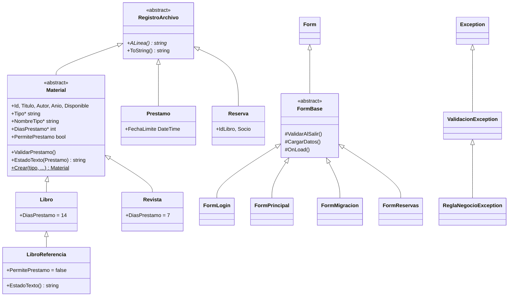
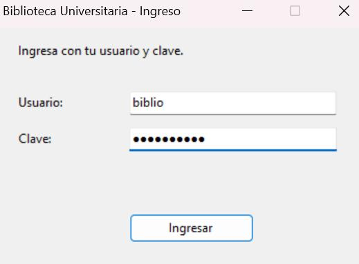
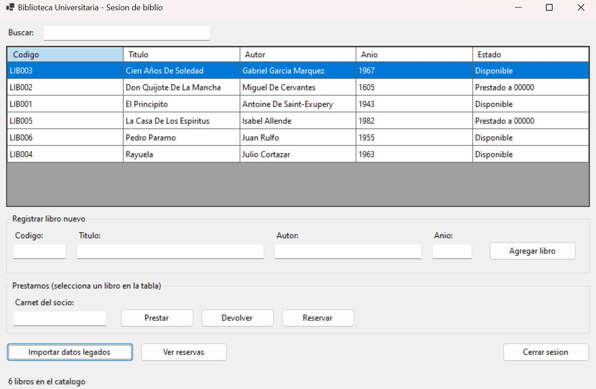
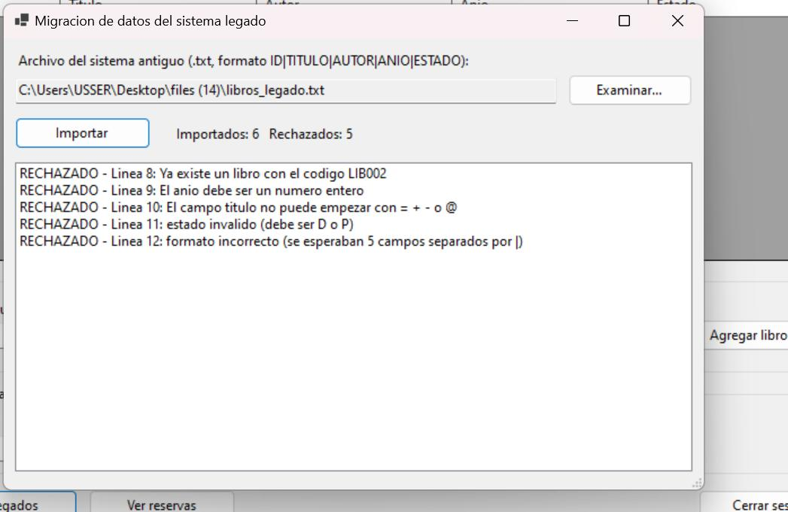
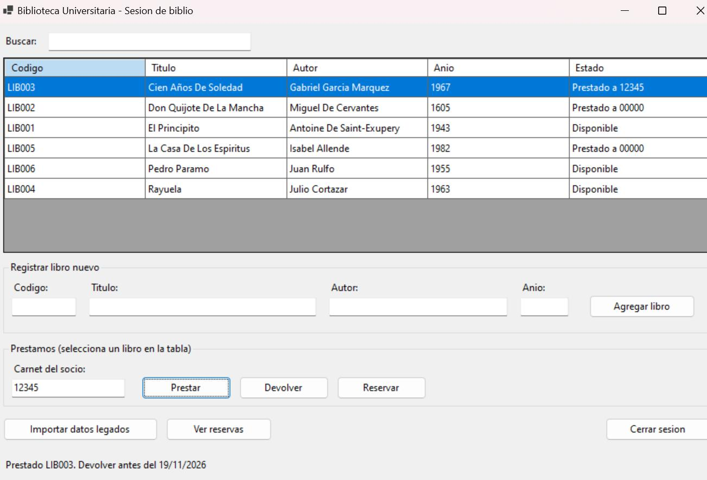
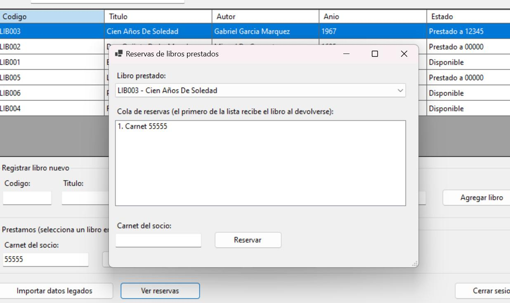
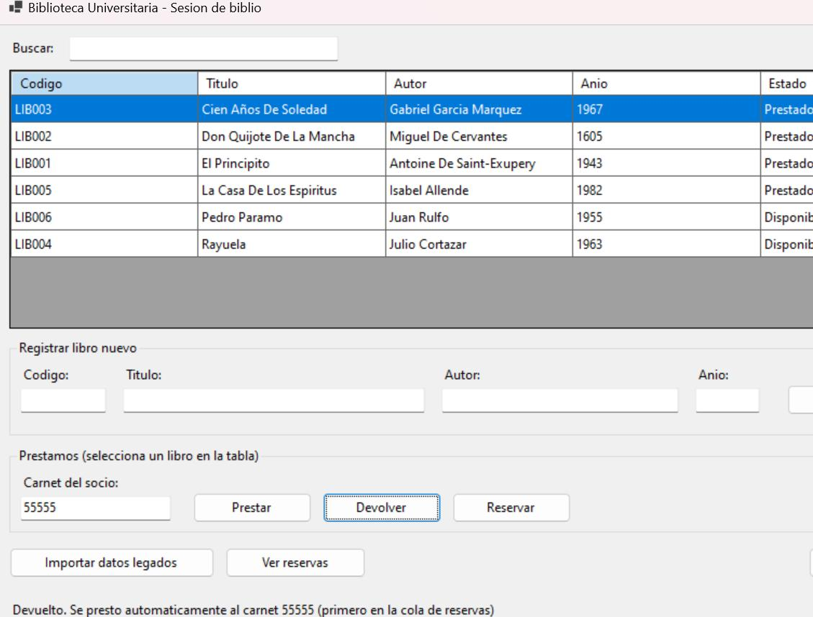
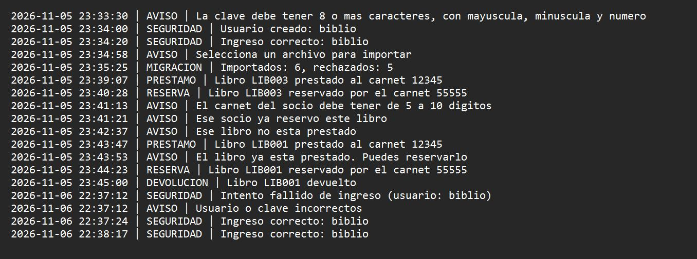

# BibliotecaUniversitaria

Sistema de gestión de una biblioteca universitaria con **migración segura de datos de un sistema legado**.
Aplicación de escritorio en **C# / Windows Forms (.NET 10)** con login protegido, catálogo, préstamos,
devoluciones, reservas en cola (FIFO) y bitácora de auditoría.

**Integrantes**

| Nombre | Usuario GitHub |
|---|---|
| Johana Candida Granado Huracaya | [Johana-77](https://github.com/Johana-77) |
| Mauricio Gabriel Terrazas Gomez | [MauT-svg](https://github.com/MauT-svg) |

---

## 1. Caso de uso

La biblioteca tenía su catálogo en un sistema antiguo que exporta un archivo de texto con una línea por libro:

```
ID|TITULO|AUTOR|ANIO|ESTADO        (ESTADO: D = disponible, P = prestado)
```

Ese sistema no validaba nada (códigos repetidos, años dañados, estados inválidos, textos peligrosos).
Este prototipo **lee el archivo, valida cada línea, rechaza las defectuosas con el motivo, normaliza lo correcto**
y lo guarda en el formato nuevo. Luego permite administrar el catálogo desde una interfaz gráfica con login.

## 2. Cómo ejecutar

Requisitos: Windows 10/11 y [.NET 10 SDK](https://dotnet.microsoft.com/download).

```bash
git clone https://github.com/Johana-77/BibliotecaUniversitaria.git
cd BibliotecaUniversitaria
dotnet run
```

También se puede abrir `BibliotecaUniversitaria.csproj` con Visual Studio 2022+ y presionar **F5**.

1. **Primer uso:** el programa pide crear el usuario del bibliotecario (clave de 8+ caracteres con mayúscula, minúscula y número).
2. Ingresar con ese usuario.
3. Pulsar **Importar datos legados** y elegir `libros_legado.txt` (archivo de ejemplo incluido: 6 líneas válidas y 5 con errores a propósito).
4. Registrar libros/revistas, prestar, devolver y reservar desde la pantalla principal.

Los datos se guardan en la carpeta `datos/` junto al ejecutable (`libros.csv`, `prestamos.csv`,
`reservas.csv`, `usuarios.txt`, `bitacora.log`). Esa carpeta está en `.gitignore` porque contiene datos y credenciales.

## 3. Arquitectura de clases (POO)

### Herencia y polimorfismo



| Jerarquía | Herencia | Polimorfismo (dónde se usa) |
|---|---|---|
| `RegistroArchivo` → `Material`, `Prestamo`, `Reserva` | Todo lo que se guarda en archivo hereda de una clase abstracta con `ALinea()` abstracto. | `Biblioteca.EscribirSeguro(List<RegistroArchivo>)` llama `ALinea()` sin saber si el objeto es un libro, un préstamo o una reserva. |
| `Material` → `Libro` → `LibroReferencia`; `Material` → `Revista` | Datos y validaciones comunes en `Material`; cada hija define `Tipo`, `NombreTipo` y `DiasPrestamo` (abstractos). | `Biblioteca` solo maneja `Material`: `ValidarPrestamo()` (una referencia no se presta), `DiasPrestamo` (14 o 7 días para la fecha límite), `EstadoTexto()` (columna Estado de la tabla). `Material.Crear` / `DesdeLinea` es una fábrica que devuelve la subclase correcta. |
| `Form` → `FormBase` → 4 pantallas | Título, tamaño, posición, `ErrorProvider` y validación `Validating` se escriben una vez en `FormBase`. | `FormBase.OnLoad()` llama al método virtual `CargarDatos()`, que `FormPrincipal` y `FormReservas` redefinen (`override`). |
| `Exception` → `ValidacionException` → `ReglaNegocioException` | Excepciones propias del dominio. | `ManejadorErrores` atrapa `ValidacionException` y usa las propiedades virtuales `TituloAviso` y `NivelBitacora`: un dato mal escrito muestra *"Dato no válido"* y una regla rota (límite de 3, libro ya prestado) muestra *"Operación no permitida"*. |

### Responsabilidad de cada clase

| Clase | Responsabilidad |
|---|---|
| `Material`, `Libro`, `Revista`, `LibroReferencia` | Modelo del catálogo. Validan sus datos en el constructor y saben convertirse a/desde una línea de archivo. |
| `Prestamo`, `Reserva` | Préstamo activo (fecha límite según el tipo de material) y reserva en cola. |
| `Biblioteca` | Lógica de negocio: catálogo, préstamos, devoluciones, reservas y persistencia. |
| `ImportadorLegado` | Migración del archivo antiguo, línea por línea, con informe de importados y rechazados. |
| `Validador` | Módulo único de validaciones (modelo, lógica, migración e interfaz). |
| `ManejadorErrores` | Manejo centralizado de excepciones y bitácora (`bitacora.log`). |
| `Seguridad`, `GestorUsuarios` | Claves con sal + PBKDF2-SHA256, comparación en tiempo constante, bloqueo por intentos. |
| `FormBase` + `FormLogin`, `FormPrincipal`, `FormMigracion`, `FormReservas` | Las 4 pantallas de la interfaz. |
| `UI`, `Rutas`, `Program` | Utilidades de controles, rutas de archivos y punto de entrada con red de seguridad de excepciones. |

## 4. Estructuras de datos y justificación

| Estructura | Uso | Por qué |
|---|---|---|
| `Dictionary<string, Material>` | Catálogo por código | Buscar, agregar y detectar duplicados en **O(1)**. Guarda cualquier subclase de `Material`. |
| `Dictionary<string, Prestamo>` | Préstamo activo de cada material | Saber en O(1) si está prestado y a quién. |
| `Dictionary<string, Queue<string>>` | Cola de reservas por material | `Queue` es **FIFO**: el primero que reservó es el primero en recibirlo. |
| `Dictionary<string, int>` | Préstamos por socio | Aplicar el límite de 3 en O(1) sin recorrer todos los préstamos. |

Los diccionarios no distinguen mayúsculas (`LIB001` = `lib001`). La migración procesa el archivo en una sola pasada (O(n)).

## 5. Reglas de negocio

- Máximo **3 préstamos por socio**, tanto en el préstamo manual **como en el préstamo automático por reserva**.
- Al devolver un material con reservas, se presta automáticamente al **primer socio de la cola que tenga cupo**.
  Si el primero ya tiene 3 libros, se lo salta pero **conserva su lugar** para la próxima devolución.
  Si nadie de la cola tiene cupo, el material queda disponible. Todo queda registrado en la bitácora:
  ```
  DEVOLUCION | Libro LIB004 devuelto
  RESERVA    | Carnet 22222 saltado en la cola de LIB004: ya tiene 3 prestamos (conserva su lugar)
  PRESTAMO   | Libro LIB004 prestado automaticamente al carnet 44444 por reserva (14 dias)
  ```
- Plazo: Libro 14 días, Revista 7 días. Los libros de referencia son solo de consulta en sala.

## 6. Validaciones

| Dato | Regla |
|---|---|
| Código | 3 a 10 letras o números, sin espacios |
| Título / autor | Obligatorio, largo máximo, sin `; \| " < >` ni caracteres de control, no puede empezar con `= + - @` |
| Año | Entero entre 1000 y el año actual |
| Carnet | 5 a 10 dígitos |
| Usuario / clave | Usuario 4–20 caracteres; clave 8+ con mayúscula, minúscula y número |
| Archivo a importar | Solo `.txt` o `.csv`, debe existir, máximo 1 MB |

En la interfaz se valida en `KeyPress` (solo dígitos), `Validating` (marca el campo con `ErrorProvider`) y `Click` (validación final).

## 7. Seguridad

| Amenaza | Medida |
|---|---|
| Robo de contraseñas | Solo se guarda sal + hash PBKDF2-SHA256 (100 000 iteraciones) |
| Fuerza bruta | Bloqueo de 30 s tras 3 intentos fallidos, mensaje genérico |
| Inyección de fórmulas CSV/Excel | Se rechazan textos que empiezan con `= + - @` |
| Archivo legado malicioso o enorme | Solo .txt/.csv, máx. 1 MB, cada línea validada |
| Archivos de datos manipulados | Se revalida cada línea al cargar; las dañadas se descartan y se registran |
| Archivos a medias | Escritura en archivo temporal y luego copia |
| Inyección en la bitácora | Se eliminan saltos de línea |
| Fuga de información | Al usuario solo mensajes genéricos; detalle técnico en la bitácora |
| Ataque de tiempo | Comparación de hashes en tiempo constante |

**Limitaciones:** los archivos no están cifrados, hay un solo rol, los préstamos migrados como `P` se asignan al carnet `00000`
(el sistema antiguo no guardaba el socio) y el bloqueo por intentos se reinicia al cerrar el programa.

## 8. Control de versiones

Se trabajó con dos ramas que luego se unieron a `main`:

- `rama-modelo-validaciones`: modelo, validaciones, excepciones, bitácora, lógica y persistencia (unida por Pull Request #1).
- `rama-interfaz-seguridad`: seguridad y login, migración y las 4 pantallas (unida a `main`).

Después del merge se agregaron en `main`: herencia y polimorfismo, el límite de 3 en el préstamo automático y este README.

## 9. Capturas

| Login | Catálogo |
|---|---|
|  |  |

| Migración (importados y rechazados) | Préstamo |
|---|---|
|  |  |

| Cola de reservas | Devolución con préstamo automático |
|---|---|
|  |  |

**Bitácora**



## 10. Estructura del repositorio

```
BibliotecaUniversitaria/
├── Program.cs                 punto de entrada
├── Material.cs                RegistroArchivo y Material (clases base abstractas)
├── Libro.cs                   Libro y LibroReferencia
├── Revista.cs                 Revista
├── Prestamo.cs                Prestamo, Reserva, ResultadoImportacion
├── Biblioteca.cs              lógica de negocio y persistencia
├── ImportadorLegado.cs        migración del sistema antiguo
├── Validacion.cs              Validador y excepciones propias
├── ManejadorErrores.cs        excepciones centralizadas y bitácora
├── Seguridad.cs, GestorUsuarios.cs
├── FormBase.cs, FormLogin.cs, FormPrincipal.cs, FormMigracion.cs, FormReservas.cs, UI.cs
├── Rutas.cs
├── libros_legado.txt          archivo de ejemplo del sistema antiguo
└── docs/capturas/             evidencias
```
